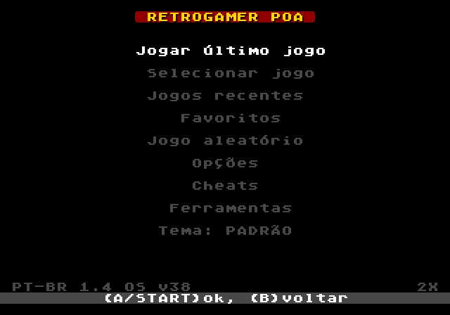
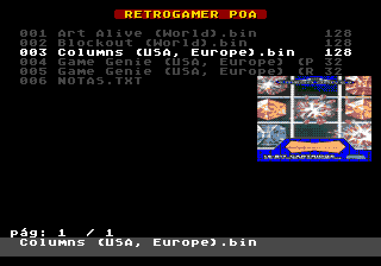
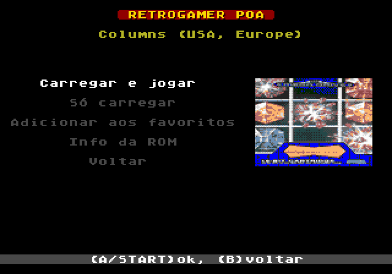
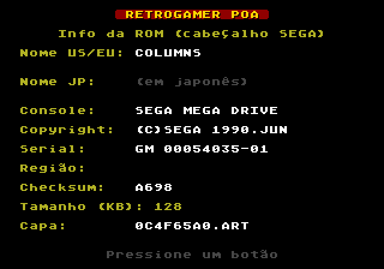
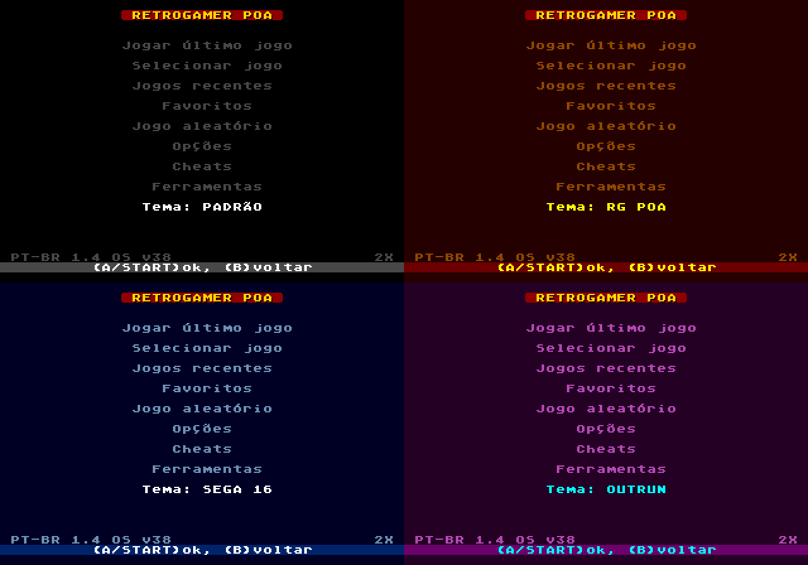
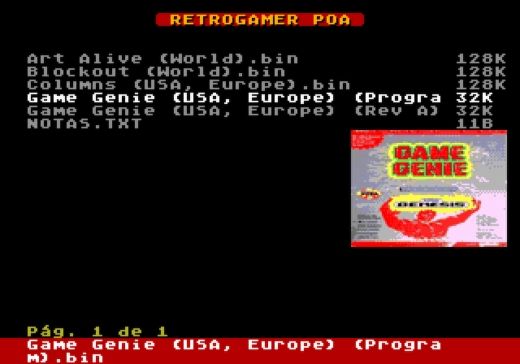

# Firmware MD Everdrive v1 & v3 Customizada e Corrigida para clones

Sistema operacional (OS) customizado em **português do Brasil** para os flashcarts
**EverDrive-MD v1** e **EverDrive-MD v3** de Mega Drive / Genesis, incluindo os clones vendidos
no Brasil e no exterior. Feito para o **Grupo RetroGamer Poa** por **Antonio e the Nobre**.



| Cartucho | Arquivo | Base | SHA-256 |
|---|---|---|---|
| EverDrive-MD **v1** | [`OS-V38-PTBR.BIN`](OS-V38-PTBR.BIN) | OS v38 (dump de um v1 clone) + logo RetroGamer POA | `da4d6b6ff137706cce428c7f692f563ff77904d3130a6ef963b44e20bea94451` |
| EverDrive-MD **v3** | [`MDOS.ptbr.BIN`](MDOS.ptbr.BIN) | `MDOS.patched` (OS v3 já usado em clones) | `97da87e69b532e8b71cc133b9f28156ea9f9d2a0ee53d2aea531ec7affc8deb1` |

> ⚠️ Projeto independente, sem relação com a Krikzz. O EverDrive e o OS original são obra de
> Igor Golubovskiy (krikzz.com). Use por sua conta e risco. **Nenhuma ROM está incluída.**

---

## Recursos

As duas versões têm o mesmo conjunto de recursos, adaptado a cada hardware:

- **Tudo em português**, com acentos (á à â ã é ê í ó ô õ ú ç) desenhados no estilo da fonte original
- **Banner "RETROGAMER POA"** nos menus e tela de créditos com o grupo
- **Jogos recentes** e **Favoritos**, salvos no cartucho (sobrevivem ao desligar)
- **Jogo aleatório**: sorteia uma ROM da sua coleção
- **Capas (box art)** dos jogos, lidas de `/EDMD/ART` no cartão SD
- **Info da ROM**: nome, console, copyright, serial, região, checksum e tamanho lidos do cabeçalho SEGA
- **4 temas de cores**: PADRÃO, RG POA, SEGA 16 e OUTRUN

| | | |
|---|---|---|
|  |  |  |
| Capa aparece ao parar sobre um jogo (v1) | Menu do jogo (botão A) | Info da ROM |



---

## EverDrive-MD v1

### Instalação
1. Copie `OS-V38-PTBR.BIN` para o cartão SD.
2. No cartucho: **Ferramentas → gravar OS** (no OS original: *toolbox → update OS*), escolha o arquivo e confirme.
3. O console reinicia sozinho com o novo OS.

### Recuperação (se algo der errado)
Segure **A + B + C** ao ligar o console. Abre o *OS repair tool* do boot loader, que grava qualquer
OS de 64 KB a partir do cartão SD (por exemplo o seu OS original). O boot loader não confere
checksum, então o cartucho não fica "brickado".

### Controles no navegador de jogos
| Botão | Ação |
|---|---|
| Cima / Baixo | move o cursor (parado ~0,3 s sobre uma ROM, a capa aparece no centro à direita) |
| Esquerda / Direita | troca de página |
| **START** | carrega e joga na hora |
| **A** | numa pasta: entra; num jogo: abre o **menu do jogo** com a capa |
| B | volta |

Menu do jogo: **Carregar e jogar**, **Só carregar**, **Adicionar aos favoritos**, **Info da ROM**, **Voltar**.
**ESQ/DIR** no menu do jogo vai para o jogo anterior/seguinte da pasta (pula pastas e arquivos que não são ROM).

Menu principal: Jogar último jogo · Selecionar jogo · Jogos recentes · Favoritos · Jogo aleatório ·
Opções · Cheats · Ferramentas · Tema. A versão do mod aparece no rodapé (**PT-BR 1.5**) e em Ferramentas → dispositivo.

### Detalhes
- Recentes e Favoritos (8 de cada) ficam no mesmo bloco de flash das opções (`0x30000`); a flash só é regravada quando a lista muda.
- Antes de carregar um recente/favorito o OS confere se o arquivo ainda é o mesmo no cartão; se você apagou ou trocou, aparece "Arquivo não encontrado no SD" em vez de carregar lixo.
- O jogo aleatório parte da última pasta aberta e desce pelas subpastas (ignora `EDMD`), escolhendo só `.bin .md .gen .smd .sms .32x`.

---

## EverDrive-MD v3

### Instalação
O v3 carrega o OS do cartão SD. Renomeie `MDOS.ptbr.BIN` para **`MDOS.BIN`** e coloque em
**`/EDMD/MDOS.BIN`** no cartão. Para voltar ao original, basta recolocar o `MDOS.BIN` original.

### Controles
| Botão | Ação |
|---|---|
| Esquerda / Direita | troca de página |
| START | repete o último jogo |
| **A** | menu do arquivo + capa (Carregar e Jogar, Só Carregar, Favoritar Jogo, Info da ROM, Ver em Hex); dentro dele, **ESQ/DIR** vai para o jogo anterior/seguinte |
| B | volta |
| **C** | menu principal (Opções, Jogos Recentes, Favoritos, Jogo Aleatório, Cheats, Info Sistema, Créditos) |

**Capa na lista:** parado ~0,3 s sobre um jogo, a capa aparece no centro à direita da lista;
qualquer botão a remove (a página é redesenhada). Rolar rápido não carrega nada.



O tema visual fica em **Opções → Tema Visual**. Recentes/Favoritos (10 de cada) ficam na SRAM do cartucho. Em **Info Sistema** a versão aparece como **PT-BR 1.5**.

---

## Capas (box art)

O repositório já traz **2176 capas prontas** em [`sd/EDMD/ART`](sd/EDMD/ART) (também disponíveis
como `EDMD-ART.zip` na página de Releases).

**Onde colocar:** copie a pasta `EDMD` de dentro de `sd/` para a **raiz do cartão SD**, ficando assim:

```
Cartão SD (E:\)
├── EDMD\
│   ├── ART\
│   │   ├── 0C4F65A0.ART
│   │   ├── 3F75B964.ART
│   │   └── ...           (2176 arquivos)
│   └── SAVE\             (já existe; é onde o OS guarda os saves)
└── (suas pastas de ROMs, em qualquer lugar)
```

Se já existir uma pasta `EDMD` no cartão, só junte o conteúdo (não apague a `SAVE`). As ROMs podem
ficar em qualquer pasta; a capa é encontrada pelo conteúdo da ROM, não pelo nome do arquivo.

Ambas as versões (v1 e v3) usam o mesmo formato: `/EDMD/ART/XXXXXXXX.ART`, onde `XXXXXXXX` é um
hash dos primeiros 512 bytes da ROM (12×9 tiles, 14 cores). Se algum jogo seu não tiver capa
(dump diferente, hack, tradução), gere as que faltam a partir das imagens da Libretro:

```
pip install pillow
python sync_roms_art.py "E:\ROMS"          # cria E:\ROMS\EDMD\ART\*.ART só para o que faltar
```

As imagens originais vêm do projeto [libretro-thumbnails](https://github.com/libretro-thumbnails).

---

## Compilando

Os arquivos originais **não** estão no repositório. Coloque-os na pasta do projeto:

| Para | Arquivos necessários |
|---|---|
| v1 (`build_v1_ptbr.py`) | `OS-V38.BIN` (dump do seu v1), `os-v36-retrogamer-poa.bin` (bloco do logo RetroGamer POA) |
| v3 (`build_custom_mdos.py`) | `MDOS.patched.BIN` |

**v1** — o código novo é C + assembly em [`v1mod/`](v1mod), compilado com GCC m68k no WSL (Debian):

```
# dentro do WSL (ou sem root: apt-get download + dpkg -x, veja v1mod/build.sh)
sudo apt install gcc-m68k-linux-gnu binutils-m68k-linux-gnu
# no Windows
pip install capstone
python build_v1_ptbr.py          # gera OS-V38-PTBR.BIN e confere todos os patches
```

O script verifica cada byte original antes de alterar, posiciona o código nas áreas livres da flash
e grava uma assinatura no fim da imagem. Se uma atualização de OS falhar no meio, os menus voltam
para as rotinas originais e você continua dentro de Ferramentas para tentar de novo.

**Testes (v1)** — `v1mod/test/` roda o OS de verdade num emulador 68000 (Unicorn) com VDP, flash,
controle e cartão SD simulados, inclusive com a checagem de alinhamento de memória do 68000 real:

```
pip install unicorn==2.1.4 pillow capstone
# gera um cartão SD de teste (FAT32) via mtools/dosfstools no WSL: mkimg.py + mkimg.sh
python t_all.py all ; python t_edge.py ; python t_preview.py ; python t_mine4.py
# v3 (emu3.py, mesmo emulador com BIOS do cartucho simulado)
python t3_preview.py ; python t3_flows.py ; python t3_lr.py ; python t3_version.py
```

**v3** — rode a partir da pasta acima de `mega-genesis/`:

```
python mega-genesis/build_custom_mdos.py
```

### Outras ferramentas
- `build_v3_dumper.py` — gera uma ROM que faz dump do OS do cartucho v3.
- `extract_sram_dump.py` — extrai o OS de um `.SRM` gerado pelo dumper.

---

## Créditos
- **EverDrive-MD** e OS original: Igor Golubovskiy — [krikzz.com](http://krikzz.com)
- **Mod PT-BR, capas, recentes, favoritos e temas**: Antonio e the Nobre
- **Grupo RetroGamer Poa**

Veja as mudanças em [CHANGELOG.md](CHANGELOG.md).
